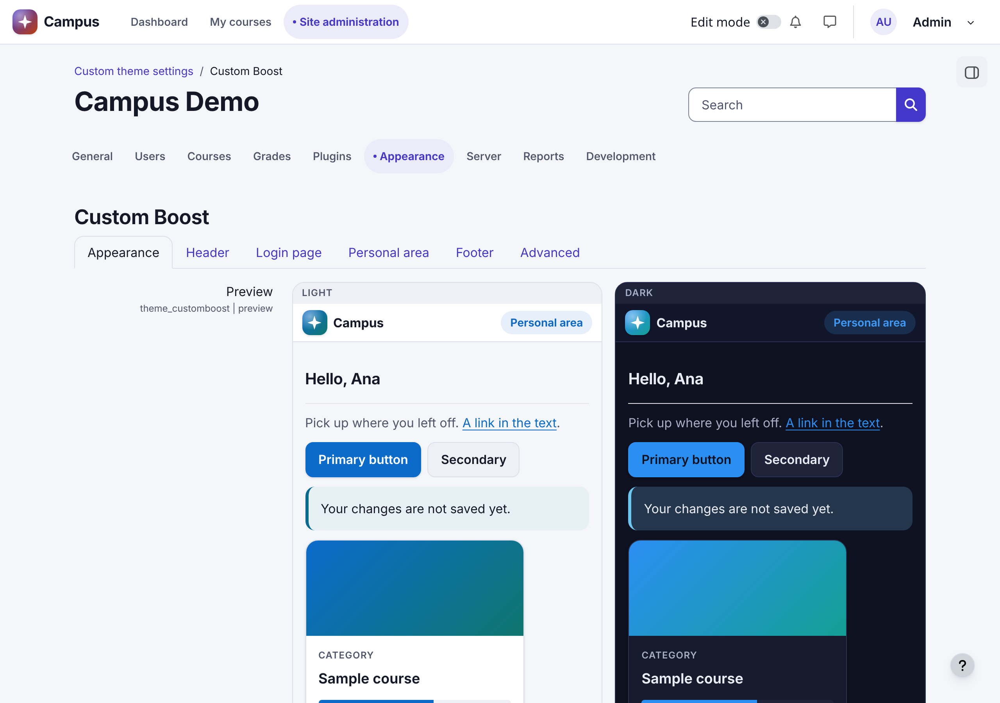
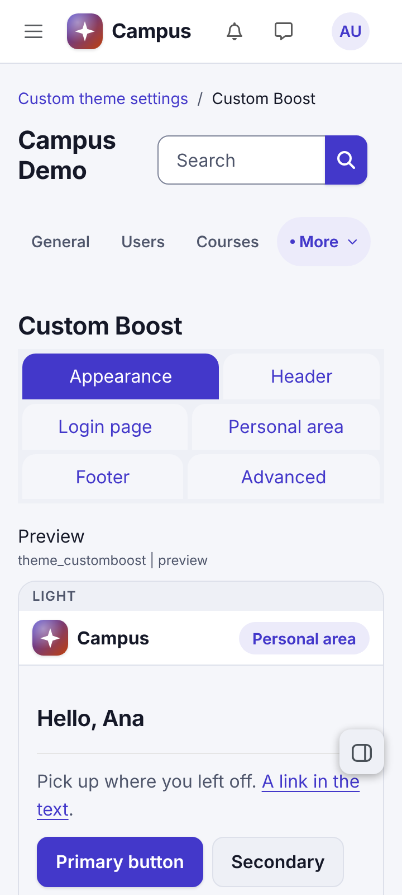
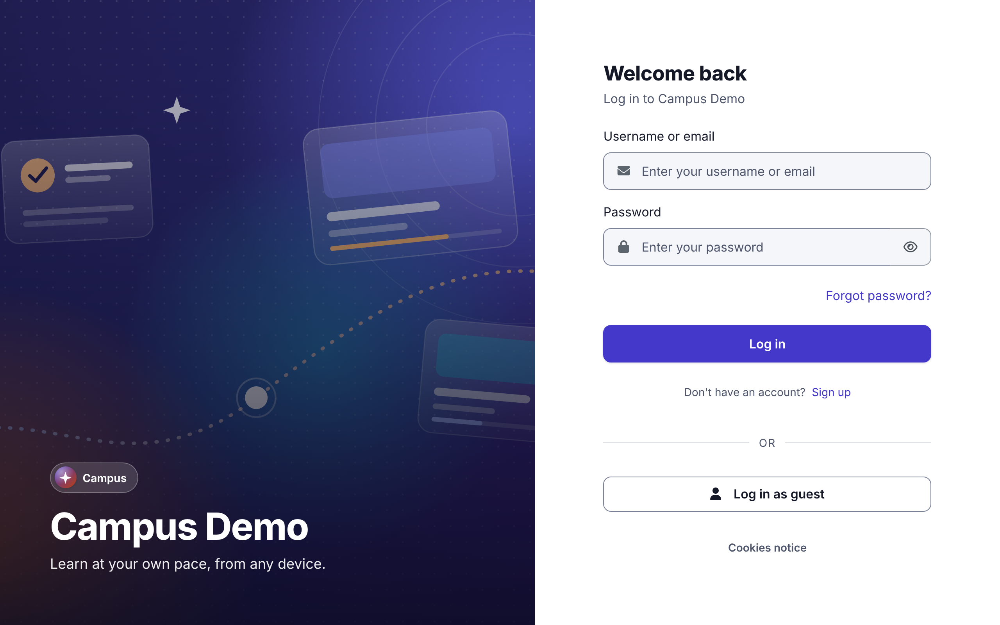
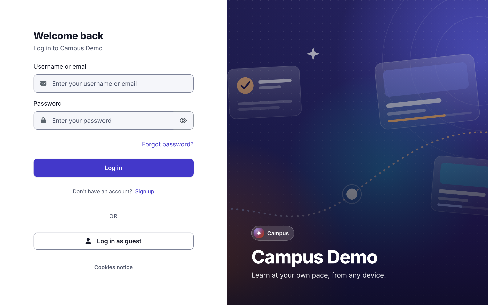
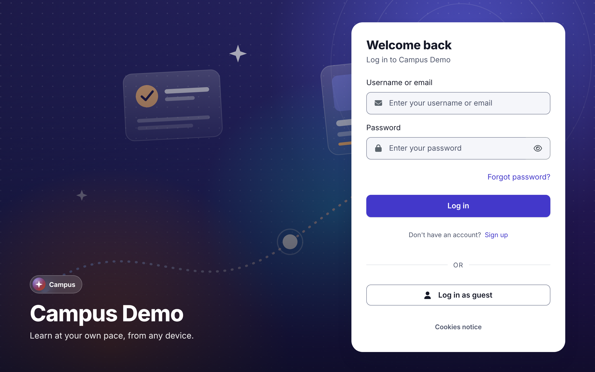
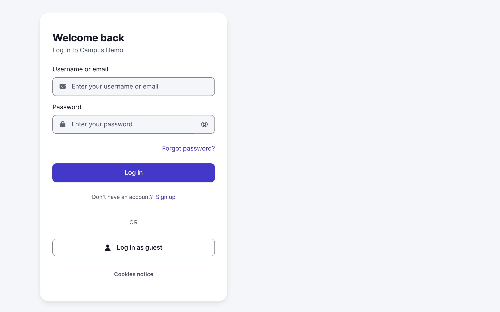
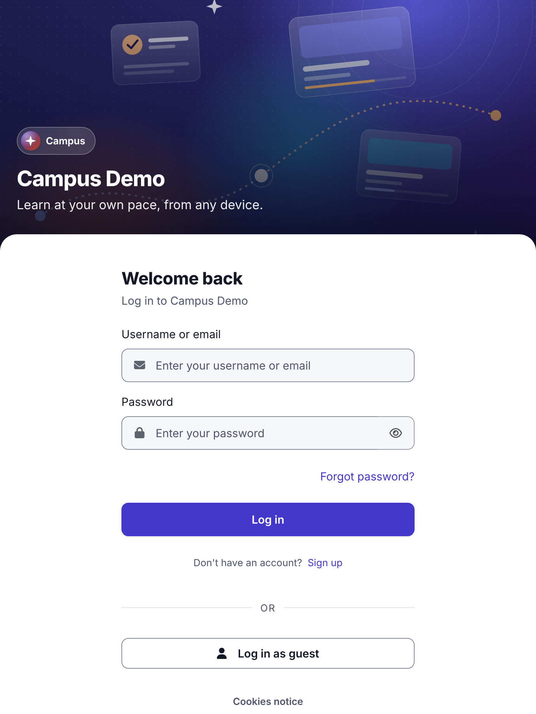
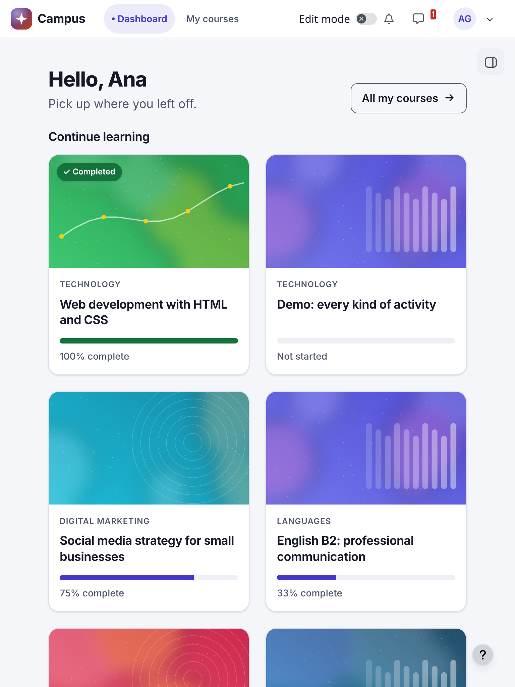
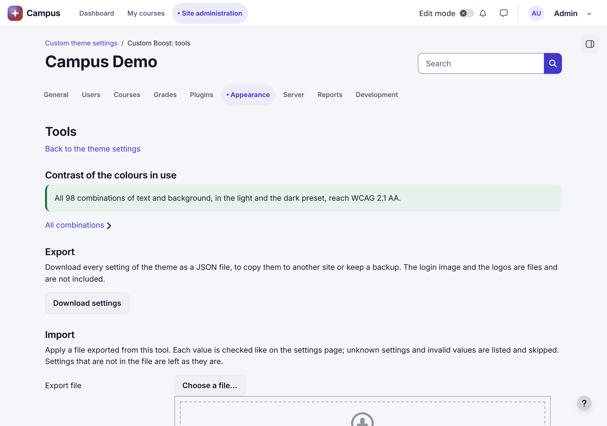

# Guía de administración · Custom Boost

Guía completa para instalar, configurar y mantener el tema **Custom Boost** (`theme_customboost`) en tu Moodle.
No hace falta saber programar: cada apartado indica dónde hacer clic y qué resultado esperar.

> Versión documentada: **0.5.0 (beta)** para **Moodle 5.3**. Las opciones marcadas como *previstas* todavía no
> existen; están descritas en el [plan de puesta a punto](PLAN-PUESTA-A-PUNTO.md).

## Índice

1. [Qué hace el tema](#1-qué-hace-el-tema)
2. [Requisitos](#2-requisitos)
3. [Instalación](#3-instalación)
4. [Activar el tema](#4-activar-el-tema)
5. [Dónde están los ajustes](#5-dónde-están-los-ajustes)
6. [Apariencia: vista previa, paleta y colores](#6-apariencia-vista-previa-paleta-y-colores)
7. [Modo claro, oscuro y automático](#7-modo-claro-oscuro-y-automático)
8. [Logotipos y nombre del sitio](#8-logotipos-y-nombre-del-sitio)
9. [Tipografía, redondeo y densidad](#9-tipografía-redondeo-y-densidad)
10. [Página de acceso](#10-página-de-acceso)
11. [Área personal y tarjetas de cursos](#11-área-personal-y-tarjetas-de-cursos)
12. [Cabecera y navegación](#12-cabecera-y-navegación)
13. [Pie de página](#13-pie-de-página)
14. [Herramientas: contraste, exportar, importar y restaurar](#14-herramientas-contraste-exportar-importar-y-restaurar)
15. [Personalización avanzada con SCSS](#15-personalización-avanzada-con-scss)
16. [Recetas rápidas](#16-recetas-rápidas)
17. [Idiomas y textos multiidioma](#17-idiomas-y-textos-multiidioma)
18. [Actualizar, desactivar y desinstalar](#18-actualizar-desactivar-y-desinstalar)
19. [Solución de problemas](#19-solución-de-problemas)
20. [Preguntas frecuentes](#20-preguntas-frecuentes)
21. [Referencia de ajustes](#21-referencia-de-ajustes)

---

## 1. Qué hace el tema

| Zona | Qué cambia |
|---|---|
| Página de acceso | Cuatro disposiciones (imagen a la izquierda, a la derecha, a toda la página o sin imagen) y un texto opcional bajo el formulario. En móvil, imagen arriba y formulario debajo. |
| Área personal | Saludo y tarjetas de cursos (recientes, en curso, destacados o todos) con categoría, progreso, fecha de fin y botón «Continuar» a elegir. |
| Cabecera | Barra compacta de 56 px con la marca visible también en móvil; logotipo específico para modo oscuro. |
| Colores | Cinco paletas listas para usar o colores propios; presets claro, oscuro y automático con contraste AA garantizado. |
| Tipografía y forma | Cuatro tipografías sin conexiones externas, cuatro tamaños de texto, cuatro redondeos y tres densidades. |
| Pie de página | Franja opcional con aviso legal, contacto o enlaces. |
| Administración | Vista previa en vivo de claro y oscuro antes de guardar; herramientas para exportar, importar y restaurar ajustes y para revisar el contraste. |
| Resto de Moodle | Botones, formularios, tarjetas, menús y alertas adoptan los mismos colores y formas. |

El tema **no** cambia el contenido de los cursos ni guarda datos personales. Es un tema hijo de Boost: todo lo que
funciona con Boost sigue funcionando.

## 2. Requisitos

| Requisito | Valor |
|---|---|
| Moodle | 5.3 (rama `MOODLE_503_STABLE`) |
| PHP | 8.3 u 8.4 |
| Tema Boost | Incluido en Moodle; no lo desinstales |
| Permisos | Cuenta de administrador del sitio (capacidad `moodle/site:config`) |

Navegadores: las dos últimas versiones de Chrome, Edge, Firefox y Safari (incluido iOS) y Chrome para Android.

## 3. Instalación

Desde Moodle 5.1 la carpeta pública es `public/`, así que el tema va en `public/theme/customboost`.

### Opción A: con Git (recomendada)

```bash
cd /ruta/a/tu/moodle
```

```bash
git clone https://github.com/ayozeweb/moodle-theme_customboost.git public/theme/customboost
```

```bash
php admin/cli/upgrade.php
```

### Opción B: con un ZIP desde la interfaz

1. Descarga el ZIP del repositorio.
2. Ve a *Administración del sitio › Extensiones › Instalar extensiones*.
3. Arrastra el ZIP, elige el tipo **Tema** si te lo pregunta y pulsa *Instalar*.
4. Confirma la actualización de la base de datos.

### Opción C: copiando la carpeta

1. Descomprime el ZIP y renombra la carpeta a `customboost`.
2. Súbela a `public/theme/` de tu servidor.
3. Entra como administrador: Moodle detecta el tema y pide actualizar.

> La carpeta debe llamarse exactamente `customboost`. Con otro nombre Moodle no reconoce el tema.

## 4. Activar el tema

1. *Administración del sitio › Apariencia › Temas*.
2. Localiza **Custom Boost** y pulsa *Seleccionar tema*.
3. Abre el sitio en otra pestaña para comprobar el resultado.

La primera carga tarda unos segundos más porque Moodle compila los estilos.

**Probar sin afectar a los usuarios.** En *Apariencia › Ajustes avanzados de temas* puedes permitir temas por
usuario o por curso y aplicarlo solo a tu cuenta o a un curso de pruebas antes de activarlo para todos.

## 5. Dónde están los ajustes

*Administración del sitio › Apariencia › Temas* y pulsa el icono de ajustes de **Custom Boost**.

Enlace directo: `https://TU-SITIO/admin/settings.php?section=themesettingcustomboost`

Hay seis pestañas:

| Pestaña | Para qué |
|---|---|
| Apariencia | Vista previa, preset de color, paleta, colores propios, logotipos para modo oscuro, tipografía, tamaño del texto, redondeo y densidad |
| Cabecera | Mostrar el nombre del sitio junto al logotipo |
| Página de acceso | Disposición, imagen, título, lema y texto bajo el formulario |
| Área personal | Tarjetas de cursos: qué cursos, cuántos, qué elementos, saludo y subtítulo |
| Pie de página | Texto del pie (aviso legal, contacto…) |
| Avanzado | Enlace a las herramientas y SCSS propio |

Además hay una página de **herramientas** en *Apariencia › Temas › Custom Boost: herramientas*
(`https://TU-SITIO/theme/customboost/tools.php`). Ver el [apartado 14](#14-herramientas-contraste-exportar-importar-y-restaurar).

Todo lo que cambia el aspecto recompila los estilos automáticamente al guardar. Algunos ajustes solo aparecen cuando
tienen efecto: los colores de marca y acento, con la paleta «Personalizada»; las opciones de tarjetas, con
*Mostrar tarjetas de cursos* marcada.



En móvil la página de ajustes se puede usar sin desplazamiento horizontal; la vista previa pone los dos paneles uno
debajo del otro:



## 6. Apariencia: vista previa, paleta y colores

### Vista previa

Arriba de la pestaña *Apariencia* hay dos paneles, **Claro** y **Oscuro**, con una cabecera, un saludo, botones,
un aviso y una tarjeta de curso de ejemplo. Se actualizan en cuanto cambias la paleta, los colores, la tipografía,
el tamaño del texto, el redondeo o la densidad, **antes de guardar**. Nada se aplica al sitio hasta que pulses
*Guardar cambios*.

Si un color no tiene contraste suficiente, bajo los paneles aparece un aviso con lo que el tema va a hacer (ver
«Ajuste automático de contraste» más abajo). Si la vista previa no se puede actualizar (por ejemplo, por una
pérdida de conexión), se indica y puedes guardar igualmente.

### Preset de color

| Opción | Efecto |
|---|---|
| Claro | Fondo claro para todos los usuarios (valor por defecto) |
| Oscuro | Fondo oscuro para todos los usuarios |
| Automático | Sigue la preferencia claro/oscuro del dispositivo de cada persona |

Este ajuste se ignora si activas los modos de color de Boost (ver [apartado 7](#7-modo-claro-oscuro-y-automático)).

### Paleta

Combinaciones de color de marca y acento ya probadas: se usan tal cual en el preset claro y se aclaran lo justo en
el oscuro.

| Paleta | Marca | Acento |
|---|---|---|
| Índigo (por defecto) | `#4338ca` | `#bd3f0c` |
| Océano | `#0b6bcb` | `#0f766e` |
| Bosque | `#147c3b` | `#975c07` |
| Granate | `#9f1239` | `#0f766e` |
| Grafito | `#334155` | `#2060eb` |
| Personalizada | El *Color de marca* | El *Color de acento* |

Debajo del selector verás «Colores en uso», con los valores que se aplican realmente en claro y en oscuro.

### Colores propios (paleta «Personalizada»)

Elige **Personalizada** en *Paleta* y aparecen dos selectores:

- **Color de marca.** Botones, enlaces, foco del teclado, navegación activa y barras de progreso.
- **Color de acento.** Destacados secundarios.

**Ajuste automático de contraste.** Si eliges un color demasiado claro para leerse sobre blanco (por ejemplo un
amarillo), el tema lo oscurece lo justo para el preset claro y lo aclara para el oscuro, conservando el tono.
«Colores en uso» lo indica con el aviso «Los colores elegidos no tenían contraste suficiente…».

| Eliges | Se usa en claro | Se usa en oscuro |
|---|---|---|
| `#4338ca` | `#4338ca` | `#8b85de` |
| `#0f6cbf` (azul Moodle) | `#0f6cbf` | `#2790ee` |
| `#ffcc00` (amarillo) | `#806600` | `#ffcc00` |

> Consejo: elige como color de marca el tono corporativo más oscuro que tengas. Cuanto menos tenga que ajustarlo el
> tema, más fiel será al original.

> **Si actualizas desde 0.2.0 o anterior** y habías cambiado los colores, la actualización selecciona la paleta
> «Personalizada» automáticamente: tu sitio conserva sus colores. Si no los habías cambiado, queda la paleta Índigo.

## 7. Modo claro, oscuro y automático

Hay dos formas de trabajar. Elige una.

### A. El administrador decide (por defecto)

Usa el ajuste *Preset de color* del tema. Todos los usuarios ven el mismo modo (o el de su dispositivo, con
*Automático*).

### B. Cada usuario elige

1. *Administración del sitio › Apariencia › Temas* y abre los ajustes de **Boost** (no los de Custom Boost).
2. Pestaña *Ajustes experimentales*.
3. Activa *Habilitar modos de color* y elige el *Modo de color por defecto*.

Aparece un selector (sol/luna) en la cabecera de los usuarios identificados. La elección se guarda como preferencia
del usuario y en una cookie llamada `theme_boost_colourmode` para que la página de acceso respete el modo. Si tu
sitio publica una política de cookies, añádela a la lista.

> Es una función que Moodle 5.3 marca como experimental. Con ella activada, el *Preset de color* de Custom Boost no
> tiene efecto.

## 8. Logotipos y nombre del sitio

Los logotipos principales son los estándar de Moodle: *Administración del sitio › Apariencia › Logotipos*.

| Ajuste | Dónde | Dónde aparece |
|---|---|---|
| Logotipo compacto | Moodle › Logotipos | Cabecera. Altura visible: 36 px. Usa SVG o PNG con fondo transparente. |
| Logotipo | Moodle › Logotipos | Encima del formulario de acceso. Altura máxima: 56 px. |
| Favicon | Moodle › Logotipos | Pestaña del navegador |
| Logotipo compacto para modo oscuro | Custom Boost › Apariencia | Cabecera en modo oscuro, también con el preset *Automático*. Necesita que exista el logotipo compacto normal. |
| Logotipo para modo oscuro | Custom Boost › Apariencia | Encima del formulario de acceso en modo oscuro. |

Formatos admitidos para los logotipos oscuros: SVG, PNG, WebP y JPG.

> **Limitación conocida.** Con el preset *Automático*, la página de acceso usa siempre el logotipo normal: el modo
> del dispositivo solo se conoce en el navegador y el logotipo grande se elige en el servidor. El de la cabecera sí
> cambia, porque se envían los dos y el navegador muestra el adecuado. Si usas *Automático*, sube un logotipo que se
> lea sobre ambos fondos o uno con fondo propio.

**Nombre del sitio.** Sin logotipo compacto, la cabecera muestra un icono con los colores de marca y acento junto
al **nombre corto** del sitio (*Administración del sitio › General › Ajustes de la página principal*). Con logotipo
compacto se muestra solo el logotipo; para mostrar también el nombre, marca *Cabecera › Mostrar el nombre del sitio
junto al logotipo*. En móvil, los nombres largos se recortan con puntos suspensivos: usa un nombre corto de verdad.

## 9. Tipografía, redondeo y densidad

Pestaña *Apariencia*, secciones *Tipografía* y *Forma y densidad*. Todos se ven en la vista previa antes de guardar.

| Ajuste | Opciones | Notas |
|---|---|---|
| Tipografía | Inter (incluida en el tema, por defecto) · Noto Sans (incluida en Moodle) · Fuente del dispositivo (system-ui) · Serif (Georgia y similares) | Ninguna se descarga de servicios externos. |
| Tamaño del texto | 15 px (por defecto de Moodle) · 16 · 17 · 18 px | Títulos, controles y espacios crecen en proporción. Los campos de formulario nunca bajan de 16 px, para que los móviles no hagan zoom al escribir. |
| Redondeo | Recto · Suave · Redondeado (por defecto) · Muy redondeado (botones en píldora) | Botones, campos, tarjetas, menús y ventanas de todo el sitio. |
| Densidad | Compacta · Normal (por defecto) · Amplia | Espaciado interior de los componentes del tema (tarjetas, cabecera, acceso). Los controles conservan 44 px de zona táctil. |

> Los tamaños empiezan en 15 px porque es la base de Moodle: un tamaño menor perjudicaría la lectura en móvil.

## 10. Página de acceso

Pestaña *Página de acceso*.

| Ajuste | Qué hace | Recomendación |
|---|---|---|
| Disposición | Imagen a la izquierda (por defecto), a la derecha, a toda la página con el formulario en una tarjeta, o sin imagen. | Se aplica desde 992 px de ancho. En móvil y tableta la imagen es una franja sobre el formulario (salvo «Sin imagen»). |
| Imagen de acceso | Imagen de fondo. Vacía: ilustración incluida en el tema. | Horizontal, mínimo 1600 px de ancho. JPG, PNG, WebP o AVIF, hasta 1 MB. |
| Título de acceso | Encabezado sobre la imagen. Vacío: nombre completo del sitio. | Máximo 40 caracteres. |
| Lema de acceso | Frase bajo el título. Vacío: «Aprende a tu ritmo, desde cualquier dispositivo». | Una sola frase. |
| Texto bajo el formulario | Editor de texto: soporte, condiciones de uso, privacidad. | Breve; admite enlaces. |

**Reducción automática.** Al guardar, las imágenes JPG, PNG y WebP de más de 2000 px de ancho se reducen a 2000 px
(calidad 85) con el mismo nombre. Las AVIF se guardan tal cual.

**Las cuatro disposiciones (1280 px).**

| Imagen a la izquierda | Imagen a la derecha |
|---|---|
|  |  |
| **Imagen a toda la página** | **Sin imagen** |
|  |  |

**En distintos tamaños** (disposición por defecto):

| Móvil (360 px) | Tableta (768 px) | Escritorio (1280 px) |
|---|---|---|
|  |  |  |

- Sobre la imagen se aplica un degradado oscuro para que el texto blanco se lea con cualquier foto. El sujeto
  principal de la foto queda mejor en la mitad superior.
- **Instrucciones de acceso.** Si rellenas *Administración del sitio › Extensiones › Identificación › Gestionar
  identificación › Instrucciones*, el texto aparece sobre la imagen en escritorio y bajo el formulario en móvil.

El formulario es el estándar de Moodle: el acceso con Google/Microsoft (OAuth 2), la verificación en dos pasos, el
registro y la recuperación de contraseña funcionan sin configuración adicional.

## 11. Área personal y tarjetas de cursos

Pestaña *Área personal*.

| Ajuste | Qué hace | Por defecto |
|---|---|---|
| Mostrar tarjetas de cursos | Muestra el saludo y las tarjetas al principio del área personal. Desmarcado, el resto de opciones se ocultan. | Activado |
| Cursos que se muestran | Ver tabla siguiente. | Visitados recientemente |
| Número de tarjetas de curso | 3, 4, 6, 8 o 12. | 6 |
| Elementos de la tarjeta | Categoría, Progreso, Fecha de fin, Botón «Continuar». La imagen y el nombre se muestran siempre. | Categoría y Progreso |
| Saludo | Encabezado. `{firstname}` se sustituye por el nombre del usuario. Vacío: «Hola, {firstname}». | Vacío |
| Subtítulo | Línea bajo el saludo, también con `{firstname}`. Vacío: «Continúa donde lo dejaste.». | Vacío |

**Qué cursos aparecen.**

| Opción | Cursos | Título de la sección |
|---|---|---|
| Visitados recientemente | Primero los visitados más recientemente; si hay hueco, el resto de sus cursos en orden alfabético (sin los ya finalizados por fecha). | Sigue aprendiendo |
| En curso | Empezados y sin terminar (mismo criterio que la vista general de cursos de Moodle). | En curso |
| Destacados | Los que el usuario ha marcado con la estrella en *Mis cursos*. | Cursos destacados |
| Todos mis cursos | Todos los cursos en los que está matriculado. | Mis cursos |

Salvo «Visitados recientemente», se ordenan por último acceso del usuario y después por nombre.

**Imagen de la tarjeta.** Es la imagen del curso: en el curso, *Configuración › Imagen del curso*. Proporción
recomendada 16:9 (por ejemplo 1280 × 720). Sin imagen, Moodle genera un patrón de color.

**Progreso.** La barra y el porcentaje solo aparecen si el curso tiene activado el *Seguimiento de finalización*
(*Configuración del curso › Rastreo de finalización*) y actividades con condiciones de finalización.

**Fecha de fin.** Solo en cursos con fecha de finalización (*Configuración del curso › Fecha de finalización del
curso*).

**Botón «Todos mis cursos».** Solo aparece si la página *Mis cursos* está activada: *Administración del sitio ›
Apariencia › Navegación › Habilitar Mis cursos*. En Moodle 5.3 viene desactivada por defecto.

| Móvil | Tableta | Escritorio |
|---|---|---|
|  |  |  |

En móvil las tarjetas forman una fila que se desliza con el dedo; desde 768 px, una rejilla.

Los bloques del área personal (Vista general de cursos, Línea de tiempo, Calendario…) siguen debajo y se gestionan
como siempre, con el *Modo de edición*.

## 12. Cabecera y navegación

Pestaña *Cabecera*: *Mostrar el nombre del sitio junto al logotipo* (ver [apartado 8](#8-logotipos-y-nombre-del-sitio)).
Lo demás se controla desde Moodle:

| Quieres… | Dónde |
|---|---|
| Añadir enlaces al menú principal | *Apariencia › Ajustes avanzados de temas › Elementos del menú personalizado* |
| Mostrar u ocultar Inicio, Área personal o Mis cursos | *Apariencia › Navegación* |
| Selector de idioma en la cabecera | *Idioma › Ajustes de idioma › Mostrar menú de idioma* |
| Elementos del menú de usuario | *Apariencia › Ajustes avanzados de temas › Elementos del menú de usuario* |

En pantallas de menos de 768 px el menú principal pasa a un panel lateral que se abre con el botón de la izquierda
de la cabecera.

## 13. Pie de página

Pestaña *Pie de página*, ajuste **Texto del pie** (editor de texto). Se muestra como una franja al final de todas
las páginas: aviso legal, contacto, enlaces a la política de privacidad… Vacío, no se muestra ninguna franja.

El texto pasa por los filtros de Moodle, así que admite contenido multiidioma (ver
[apartado 17](#17-idiomas-y-textos-multiidioma)). El botón de ayuda y los enlaces estándar del pie de Moodle
(«Resumen de retención de datos», «Descargar la app»…) no cambian.

## 14. Herramientas: contraste, exportar, importar y restaurar

*Administración del sitio › Apariencia › Temas › Custom Boost: herramientas*, o el enlace de la pestaña *Avanzado*.
Requiere ser administrador del sitio.



### Contraste de los colores en uso

Comprueba las 98 combinaciones de texto y fondo de los presets claro y oscuro con los colores guardados y muestra
el ratio de cada una. Con los ajustes de color siempre cumplen AA; si algo falla, la causa está en el SCSS propio.

También existe por línea de comandos, útil para probar colores antes de guardarlos:

```bash
php public/theme/customboost/cli/contrast.php --brand='#0f6cbf' --accent='#f98012'
```

Termina con código 0 si todo cumple y 1 si algo falla.

### Exportar

*Descargar ajustes* genera un archivo JSON con todos los ajustes del tema (incluido el SCSS propio). La imagen de
acceso y los logotipos son archivos y **no** se incluyen: súbelos a mano en el otro sitio.

### Importar

Elige un archivo exportado o pega su contenido y pulsa *Importar ajustes*. Cada valor se valida igual que en la
página de ajustes. Al terminar se muestra un resumen:

| En el resumen | Significa |
|---|---|
| cambiados | Valores aplicados. |
| ya tenían ese valor | Nada que hacer. |
| rechazados | Valor no válido (por ejemplo, una paleta que no existe), o ajuste fijado en `config.php` («Definido en config.php»). Se omite. |
| desconocidos | Ajustes que no existen en esta versión del tema. Se omiten. |

Los ajustes que no estén en el archivo no se tocan. Un archivo que no sea una exportación de este tema se rechaza
entero, sin cambiar nada.

### Restaurar valores por defecto

Devuelve todos los ajustes del tema a su valor por defecto, tras pedir confirmación. La imagen de acceso y los
logotipos se conservan. Los ajustes fijados en `config.php` no se tocan.

> Consejo: exporta antes de restaurar o de importar; así puedes volver atrás importando la copia.

## 15. Personalización avanzada con SCSS

Pestaña *Avanzado*. Pensada para quien sabe algo de CSS; el resto de la guía no la necesita.

| Campo | Cuándo se aplica | Úsalo para |
|---|---|---|
| SCSS inicial en bruto | Antes que todo lo demás | Cambiar variables de Bootstrap |
| SCSS en bruto | Al final de la hoja de estilos | Reglas CSS propias y cambios de tokens |

Antes de recurrir al SCSS, revisa si lo que buscas ya es un ajuste: paleta, tipografía, tamaño del texto, redondeo
y densidad ya no necesitan código.

### Cambiar tokens

El tema expone sus valores de diseño como variables CSS `--ct-*`. Cambiarlas es la forma más segura de
personalizar: afectan a todo el tema de forma coherente. Lista completa en [tokens.md](tokens.md).

Pega en *SCSS en bruto*, por ejemplo:

```scss
:root {
    --ct-content-max: 1400px;    // Ancho máximo del contenido.
    --ct-shadow-md: none;        // Tarjetas sin sombra.
}
```

> **No cambies colores con `--ct-color-*` a mano** salvo que compruebes el contraste: esos valores los calcula el
> tema para garantizar AA. Para cambiar colores usa la paleta o los selectores de la pestaña *Apariencia*, y después
> revisa el informe de contraste de las herramientas.

Moodle valida el código al guardar y rechaza el SCSS con errores de sintaxis. Si aun así una compilación fallara,
el sitio no se rompe: se usan los estilos de respaldo de Boost. Si tras guardar el sitio se ve como Boost, revisa el
último cambio.

## 16. Recetas rápidas

| Quiero… | Cómo |
|---|---|
| Cambiar los colores sin pensar en el contraste | *Apariencia › Paleta*: elige una y mira la vista previa. |
| Usar mis colores corporativos | *Apariencia › Paleta › Personalizada* y los dos selectores. Revisa «Colores en uso». |
| Sitio siempre oscuro | *Apariencia › Preset de color › Oscuro*. Sube también los logotipos para modo oscuro si hace falta. |
| Que cada persona elija claro/oscuro | Activa los modos de color en los ajustes de **Boost** ([apartado 7](#7-modo-claro-oscuro-y-automático)). |
| Poner mi logotipo en la cabecera | *Apariencia › Logotipos › Logotipo compacto* (de Moodle). |
| Logotipo y nombre a la vez | *Cabecera › Mostrar el nombre del sitio junto al logotipo*. |
| Texto más grande para todo el sitio | *Apariencia › Tamaño del texto*: 16 o 17 px. |
| Esquinas rectas | *Apariencia › Redondeo › Recto*. |
| Interfaz más compacta | *Apariencia › Densidad › Compacta*. |
| Formulario de acceso sobre una foto a pantalla completa | *Página de acceso › Disposición › Imagen a toda la página*. |
| Enlace de soporte bajo el formulario de acceso | *Página de acceso › Texto bajo el formulario*. |
| Mostrar los cursos en curso en vez de los recientes | *Área personal › Cursos que se muestran › En curso*. |
| Cambiar el saludo del área personal | *Área personal › Saludo*, por ejemplo `Bienvenida, {firstname}`. |
| Quitar las tarjetas del área personal | *Área personal*: desmarca *Mostrar tarjetas de cursos*. |
| Aviso legal en todas las páginas | *Pie de página › Texto del pie*. |
| Copiar la configuración a otro Moodle | Herramientas › *Exportar* aquí e *Importar* allí ([apartado 14](#14-herramientas-contraste-exportar-importar-y-restaurar)). |
| Volver a los valores de fábrica | Herramientas › *Restaurar valores por defecto*. |

## 17. Idiomas y textos multiidioma

El tema incluye sus textos en **español** e **inglés** y sigue el idioma de cada usuario.

**Cambiar un texto del tema** (por ejemplo «Sigue aprendiendo»): *Administración del sitio › Idioma ›
Personalización del idioma*, elige el idioma, componente `theme_customboost`, edita la cadena y guarda. Cadenas más
habituales:

| Cadena | Texto |
|---|---|
| `greeting` | «Hola, {nombre}» (si *Saludo* está vacío) |
| `greeting_subtitle` | «Continúa donde lo dejaste.» (si *Subtítulo* está vacío) |
| `dashboardsection_recent`, `dashboardsection_inprogress`, `dashboardsection_starred`, `dashboardsection_all` | Título de la sección de tarjetas según los cursos mostrados |
| `logintagline_default` | Lema de acceso por defecto |
| `allmycourses` | Botón «Todos mis cursos» |
| `continuecourse` | «Continuar» en las tarjetas |

> Si actualizas desde 0.2.0 y habías personalizado la cadena `coursesinprogress`, ya no existe: pasa tu texto a
> `dashboardsection_recent`.

**Textos de los ajustes en varios idiomas.** El saludo, el subtítulo, el título y el lema de acceso, el texto bajo el
formulario y el texto del pie admiten el formato multiidioma de Moodle:

```html
<span lang="es" class="multilang">Hola, {firstname}</span><span lang="en" class="multilang">Hello, {firstname}</span>
```

Para que funcione hay que activar el filtro: *Administración del sitio › Extensiones › Filtros › Gestionar
filtros*, pon **Contenido multiidioma** en *Activado* y, en su columna *Aplicar a*, elige **Contenido y
encabezados** (el saludo y los títulos son encabezados). Sin el filtro se mostrarían todos los idiomas seguidos.

## 18. Actualizar, desactivar y desinstalar

**Actualizar**

```bash
cd public/theme/customboost
```

```bash
git pull
```

```bash
php ../../../admin/cli/upgrade.php
```

Con ZIP: sustituye la carpeta completa por la nueva y visita *Administración del sitio › Notificaciones*. Los
ajustes se conservan. Antes, exporta los ajustes desde las herramientas del tema.

**Novedades al pasar de 0.2.0 a 0.5.0**

- Si habías cambiado los colores, se selecciona la paleta «Personalizada» y se conservan.
- El acento por defecto pasa de `#c2410c` a `#bd3f0c`, el valor que ya se mostraba tras el ajuste de contraste.
- Las fuentes y radios de *SCSS inicial en bruto* siguen funcionando, pero ahora tienen sus propios ajustes;
  conviene pasarlos a la pestaña *Apariencia* y vaciar el código.
- La cadena `coursesinprogress` se sustituye por `dashboardsection_*` ([apartado 17](#17-idiomas-y-textos-multiidioma)).

**Desactivar.** *Apariencia › Temas*, selecciona otro tema (por ejemplo Boost). Los ajustes de Custom Boost se
conservan por si vuelves.

**Desinstalar.** Primero selecciona otro tema. Después *Administración del sitio › Extensiones › Vista general de
extensiones*, busca *Custom Boost* y pulsa *Desinstalar*. Se borran sus ajustes, la imagen de acceso y los
logotipos para modo oscuro.

## 19. Solución de problemas

| Síntoma | Causa probable | Solución |
|---|---|---|
| Tras instalar, el sitio se ve como Boost | El tema no está seleccionado o los estilos están en caché | Selecciónalo en *Apariencia › Temas*; después *Desarrollo › Purgar todas las cachés*. |
| El sitio se ve como Boost después de editar SCSS | Error de sintaxis en *SCSS en bruto* | Deshaz el último cambio y guarda. |
| Cambio un color y no pasa nada | Caché del navegador | Recarga con Ctrl+F5. Si persiste, purga cachés. |
| No veo los selectores de color de marca y acento | La paleta no es «Personalizada» | *Apariencia › Paleta › Personalizada*. |
| El color que veo no es el que elegí | Ajuste automático de contraste | Es intencionado; mira «Colores en uso». Elige un tono más oscuro para acercarte al original. |
| La vista previa dice que no se ha podido actualizar | Sesión caducada o conexión perdida | Recarga la página. Los ajustes se pueden guardar igualmente. |
| Un ajuste aparece gris con «Definido en config.php» | Está fijado en `config.php` | Cámbialo allí. La importación y la restauración también lo respetan. |
| El preset oscuro no se aplica | Los modos de color de Boost están activados | Desactívalos o cambia el modo por defecto en Boost ([apartado 7](#7-modo-claro-oscuro-y-automático)). |
| El logotipo oscuro no aparece en la página de acceso | Preset *Automático* | Limitación conocida ([apartado 8](#8-logotipos-y-nombre-del-sitio)). Usa *Oscuro* o un logotipo válido para ambos fondos. |
| El logotipo compacto oscuro no aparece | Falta el logotipo compacto normal | Súbelo en *Apariencia › Logotipos*. |
| El saludo muestra varios idiomas seguidos | Filtro multiidioma desactivado o solo para contenido | [Apartado 17](#17-idiomas-y-textos-multiidioma): actívalo para *Contenido y encabezados*. |
| No veo el botón «Todos mis cursos» | *Mis cursos* está desactivado | *Apariencia › Navegación › Habilitar Mis cursos*. |
| Las tarjetas no muestran progreso | El curso no tiene seguimiento de finalización, o el elemento *Progreso* está desmarcado | Actívalo en el curso y revisa *Elementos de la tarjeta*. |
| Las tarjetas no aparecen | Ajuste desactivado, o el usuario no tiene cursos de ese tipo | Revisa *Área personal*; con «Destacados», el usuario debe marcar alguno. Sin cursos se muestra un aviso. |
| La importación rechaza un ajuste | Valor no válido en esta versión, o fijado en `config.php` | El resumen indica el motivo; el resto se aplica igualmente. |
| La imagen de acceso se ve recortada | Proporción distinta a la pantalla | Es normal (se ajusta para cubrir). Centra el motivo y evita texto dentro de la imagen. |
| No puedo subir la imagen de acceso | Supera 1 MB o el formato no está admitido | Expórtala como JPG o WebP; las grandes se reducen solas al guardar. |
| El nombre del sitio sale cortado en móvil | Nombre corto demasiado largo | Acórtalo o sube un logotipo compacto. |
| Mensaje sobre `max_input_vars` | Requisito de Moodle 5.x, no del tema | Pon `max_input_vars = 5000` en `php.ini`. |

**Purgar cachés por línea de comandos:**

```bash
php admin/cli/purge_caches.php
```

Si necesitas ayuda, abre una incidencia en el repositorio indicando versión de Moodle, versión del tema
(*Extensiones › Vista general*), navegador, ancho de pantalla y una captura. Adjunta la exportación de ajustes si el
problema es de aspecto.

## 20. Preguntas frecuentes

**¿Afecta a la app móvil de Moodle?** No. La app oficial usa su propia interfaz; el tema se aplica al acceso por
navegador (también desde el móvil).

**¿Carga algo de servidores externos?** No. Fuentes, iconos e imágenes se sirven desde tu Moodle. No hay CDN ni
analítica.

**¿Funciona con una política de seguridad de contenido (CSP) estricta?** Sí, con una excepción: el preset
*Automático* usa un pequeño script en línea para leer la preferencia claro/oscuro del dispositivo (igual que Boost).
Si tu CSP prohíbe scripts en línea, usa el preset *Claro* u *Oscuro*.

**¿El modo oscuro funciona en todas las páginas de Moodle?** En las más usadas, sí: el tema se ha revisado en
35 páginas (curso, actividades, calificaciones, participantes, calendario, mensajería, perfil, administración…)
a 360, 768 y 1280 px. El modo oscuro de Moodle 5.3 es experimental y algunas extensiones del core todavía usan
colores fijos; el tema corrige los de la tarea y el informe de calificaciones del usuario. Si encuentras texto
ilegible en otra página en oscuro, abre una incidencia con la URL y una captura.

**¿Hay problemas de accesibilidad conocidos?** Los que quedan vienen de Moodle y ocurren igual con Boost: el
calificador y la lista de entregas de una tarea son tablas anchas que obligan a desplazarse en horizontal en el
móvil, el botón de borrado masivo en modo edición queda pequeño a 360 px y la página de mensajes tiene un elemento
enfocable oculto. Están detallados en el [informe de verificación](informes/2026-11-18.md).

**¿El editor de texto usa el aspecto del tema?** Sí en tipografía y formas. Los colores de marca no se aplican
dentro del área de edición.

**¿Guarda datos personales?** No. La preferencia claro/oscuro, si activas los modos de color, la guarda Boost.

**¿Quién puede cambiar los ajustes o usar las herramientas?** Solo quien tenga la capacidad `moodle/site:config`
(administradores del sitio). La vista previa también la exige.

**¿Es compatible con otros formatos de curso y extensiones?** Sí, con cualquiera que funcione con Boost. Está
preparado para compartir estilos con `format_customtiles` mediante los tokens `--ct-*`.

**¿Puedo usarlo en producción?** La versión 0.5.0 es beta: las funciones están completas, pero falta la revisión
de seguridad, accesibilidad y compatibilidad de las fases siguientes. Pruébala antes en un entorno de pruebas; el
[plan de puesta a punto](PLAN-PUESTA-A-PUNTO.md) detalla lo que falta para la versión estable.

**¿Funciona con idiomas de derecha a izquierda?** Moodle genera la hoja de estilos RTL automáticamente; aún no
está verificado pantalla a pantalla (previsto en el plan).

**¿Puedo tener colores distintos por categoría o curso?** Todavía no; está *previsto*.

## 21. Referencia de ajustes

| Ajuste (clave) | Pestaña | Tipo | Por defecto | Valores / notas |
|---|---|---|---|---|
| Preset de color (`colourpreset`) | Apariencia | Lista | `light` | `light`, `dark`, `auto`. Se ignora con los modos de color de Boost activos. |
| Paleta (`palette`) | Apariencia | Lista | `indigo` | `indigo`, `ocean`, `forest`, `garnet`, `graphite`, `custom`. |
| Color de marca (`brandcolour`) | Apariencia | Color | `#4338ca` | Solo con `palette = custom`. Ajustado a AA. |
| Color de acento (`accentcolour`) | Apariencia | Color | `#c2410c` | Solo con `palette = custom`. Ajustado a AA. |
| Logotipo para modo oscuro (`logodark`) | Apariencia | Archivo | Vacío | SVG, PNG, WebP, JPG. No se exporta. |
| Logotipo compacto para modo oscuro (`logocompactdark`) | Apariencia | Archivo | Vacío | Igual. Necesita el logotipo compacto de Moodle. |
| Tipografía (`fontfamily`) | Apariencia | Lista | `inter` | `inter`, `noto`, `system`, `serif`. |
| Tamaño del texto (`fontsize`) | Apariencia | Lista | `15` | `15`, `16`, `17`, `18` (px). |
| Redondeo (`radius`) | Apariencia | Lista | `rounded` | `square`, `soft`, `rounded`, `extra`. |
| Densidad (`density`) | Apariencia | Lista | `normal` | `compact`, `normal`, `comfortable`. |
| Mostrar el nombre del sitio (`showsitename`) | Cabecera | Casilla | No | |
| Disposición (`loginlayout`) | Página de acceso | Lista | `left` | `left`, `right`, `cover`, `plain`. |
| Imagen de acceso (`loginimage`) | Página de acceso | Archivo | Ilustración del tema | JPG, PNG, WebP, AVIF; hasta 1 MB; se reduce a 2000 px. No se exporta. |
| Título de acceso (`logintitle`) | Página de acceso | Texto | Nombre del sitio | Texto plano. |
| Lema de acceso (`logintagline`) | Página de acceso | Texto | Lema por defecto | Texto plano. |
| Texto bajo el formulario (`loginfootertext`) | Página de acceso | HTML | Vacío | |
| Mostrar tarjetas de cursos (`dashboardcourses`) | Área personal | Casilla | Sí | |
| Cursos que se muestran (`dashboardsource`) | Área personal | Lista | `recent` | `recent`, `inprogress`, `starred`, `all`. |
| Número de tarjetas (`dashboardcoursecount`) | Área personal | Lista | 6 | 3, 4, 6, 8, 12. |
| Elementos de la tarjeta (`dashboardcardelements`) | Área personal | Casillas | `category,progress` | Lista separada por comas de `category`, `progress`, `enddate`, `continue`. |
| Saludo (`dashboardgreeting`) | Área personal | Texto | Vacío | `{firstname}`; multiidioma. |
| Subtítulo (`dashboardsubtitle`) | Área personal | Texto | Vacío | `{firstname}`; multiidioma. |
| Texto del pie (`footertext`) | Pie de página | HTML | Vacío | |
| SCSS inicial en bruto (`scsspre`) | Avanzado | Código | Vacío | Variables de Bootstrap. |
| SCSS en bruto (`scss`) | Avanzado | Código | Vacío | Reglas y tokens propios. |

Todos se guardan en la configuración del componente `theme_customboost` y pueden fijarse desde `config.php`; la
página de ajustes los muestra bloqueados con «Definido en config.php», y la importación y la restauración no los
tocan. Por ejemplo:

```php
$CFG->forced_plugin_settings['theme_customboost'] = ['colourpreset' => 'dark', 'palette' => 'ocean'];
```

O por línea de comandos (después, purga las cachés para recompilar los estilos):

```bash
php admin/cli/cfg.php --component=theme_customboost --name=palette --set=ocean
```
