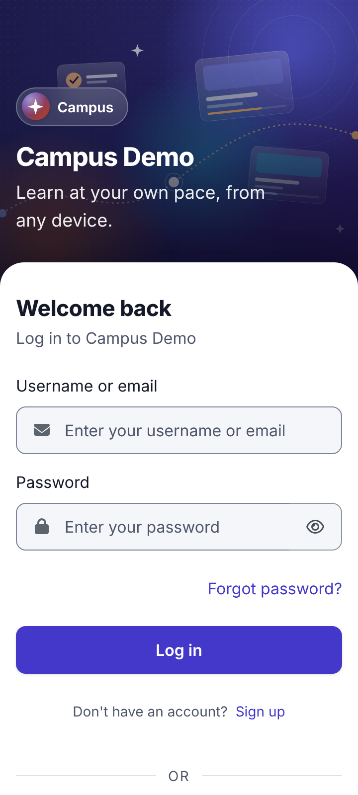
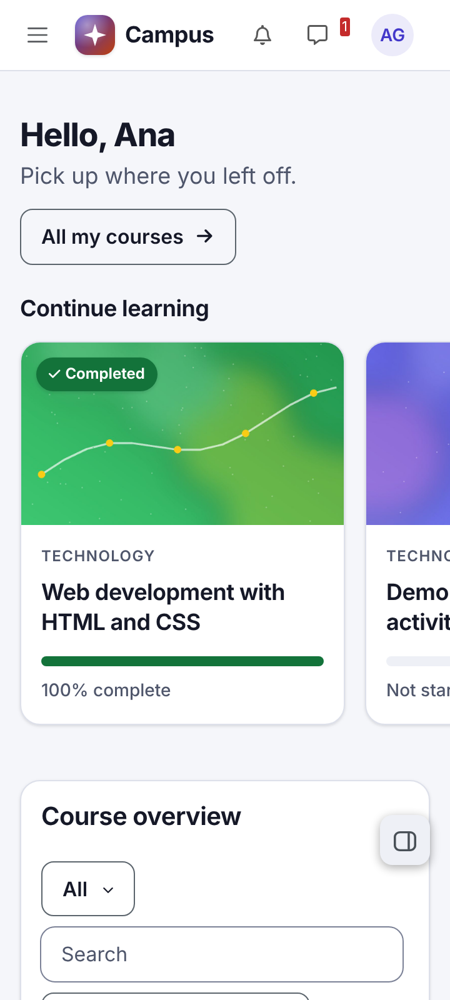
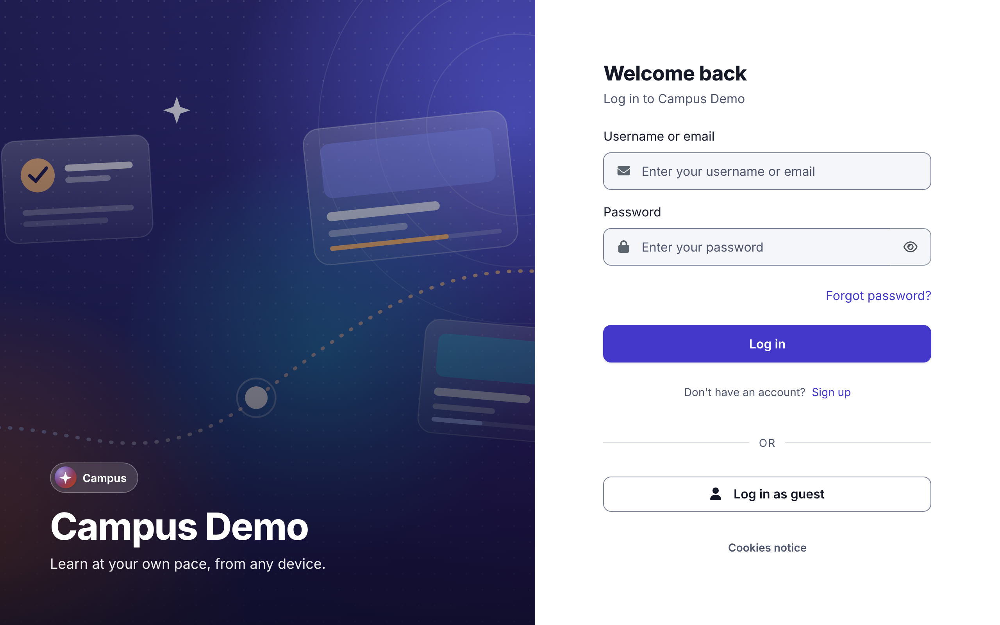

# Guía de administración · Custom Boost

Guía completa para instalar, configurar y mantener el tema **Custom Boost** (`theme_customboost`) en tu Moodle.
No hace falta saber programar: cada apartado indica dónde hacer clic y qué resultado esperar.

> Versión documentada: **0.2.0 (alfa)** para **Moodle 5.3**. Las opciones marcadas como *previstas* todavía no
> existen; están descritas en el [plan de puesta a punto](PLAN-PUESTA-A-PUNTO.md).

## Índice

1. [Qué hace el tema](#1-qué-hace-el-tema)
2. [Requisitos](#2-requisitos)
3. [Instalación](#3-instalación)
4. [Activar el tema](#4-activar-el-tema)
5. [Dónde están los ajustes](#5-dónde-están-los-ajustes)
6. [Apariencia: preset y colores](#6-apariencia-preset-y-colores)
7. [Modo claro, oscuro y automático](#7-modo-claro-oscuro-y-automático)
8. [Logotipo y nombre del sitio](#8-logotipo-y-nombre-del-sitio)
9. [Página de acceso](#9-página-de-acceso)
10. [Área personal y tarjetas de cursos](#10-área-personal-y-tarjetas-de-cursos)
11. [Cabecera y navegación](#11-cabecera-y-navegación)
12. [Personalización avanzada con SCSS](#12-personalización-avanzada-con-scss)
13. [Recetas rápidas](#13-recetas-rápidas)
14. [Comprobar el contraste](#14-comprobar-el-contraste)
15. [Idiomas](#15-idiomas)
16. [Actualizar, desactivar y desinstalar](#16-actualizar-desactivar-y-desinstalar)
17. [Solución de problemas](#17-solución-de-problemas)
18. [Preguntas frecuentes](#18-preguntas-frecuentes)
19. [Referencia de ajustes](#19-referencia-de-ajustes)

---

## 1. Qué hace el tema

| Zona | Qué cambia |
|---|---|
| Página de acceso | Imagen a un lado y formulario al otro (en móvil, imagen arriba y formulario debajo). |
| Área personal | Saludo y tarjetas «Sigue aprendiendo» con los cursos visitados recientemente y su progreso. |
| Cabecera | Barra compacta de 56 px con la marca visible también en móvil. |
| Colores | Presets claro, oscuro y automático; color de marca y de acento con contraste AA garantizado. |
| Tipografía | Fuente Inter servida desde tu propio servidor (sin conexiones externas). |
| Resto de Moodle | Botones, formularios, tarjetas, menús y alertas adoptan los mismos colores y formas. |

El tema **no** cambia el contenido de los cursos ni guarda datos personales. Es un tema hijo de Boost: todo lo que
funciona con Boost sigue funcionando.

## 2. Requisitos

| Requisito | Valor |
|---|---|
| Moodle | 5.3 (rama `MOODLE_503_STABLE`) |
| PHP | 8.3 u 8.4 |
| Tema Boost | Incluido en Moodle; no lo desinstales |
| Permisos | Cuenta de administrador del sitio |

Navegadores: las dos últimas versiones de Chrome, Edge, Firefox y Safari (incluido iOS) y Chrome para Android.

## 3. Instalación

Desde Moodle 5.1 la carpeta pública es `public/`, así que el tema va en `public/theme/customboost`.

### Opción A: con Git (recomendada)

```bash
cd /ruta/a/tu/moodle
```

```bash
git clone https://github.com/ayozeweb/moodle-theme_customboost.git public/theme/customboost
```

```bash
php admin/cli/upgrade.php
```

### Opción B: con un ZIP desde la interfaz

1. Descarga el ZIP del repositorio.
2. Ve a *Administración del sitio › Extensiones › Instalar extensiones*.
3. Arrastra el ZIP, elige el tipo **Tema** si te lo pregunta y pulsa *Instalar*.
4. Confirma la actualización de la base de datos.

### Opción C: copiando la carpeta

1. Descomprime el ZIP y renombra la carpeta a `customboost`.
2. Súbela a `public/theme/` de tu servidor.
3. Entra como administrador: Moodle detecta el tema y pide actualizar.

> La carpeta debe llamarse exactamente `customboost`. Con otro nombre Moodle no reconoce el tema.

## 4. Activar el tema

1. *Administración del sitio › Apariencia › Temas*.
2. Localiza **Custom Boost** y pulsa *Seleccionar tema*.
3. Abre el sitio en otra pestaña para comprobar el resultado.

La primera carga tarda unos segundos más porque Moodle compila los estilos.

**Probar sin afectar a los usuarios.** En *Apariencia › Ajustes avanzados de temas* puedes permitir temas por
usuario o por curso y aplicarlo solo a tu cuenta o a un curso de pruebas antes de activarlo para todos.

## 5. Dónde están los ajustes

*Administración del sitio › Apariencia › Temas* y pulsa el icono de ajustes de **Custom Boost**.

Enlace directo: `https://TU-SITIO/admin/settings.php?section=themesettingcustomboost`

Hay cuatro pestañas:

| Pestaña | Para qué |
|---|---|
| Apariencia | Preset de color, color de marca y color de acento |
| Página de acceso | Imagen, título y lema |
| Área personal | Tarjetas de cursos |
| Avanzado | SCSS propio |

Los cambios de color recompilan los estilos automáticamente al guardar.


## 6. Apariencia: preset y colores

### Preset de color

| Opción | Efecto |
|---|---|
| Claro | Fondo claro para todos los usuarios (valor por defecto) |
| Oscuro | Fondo oscuro para todos los usuarios |
| Automático | Sigue la preferencia claro/oscuro del dispositivo de cada persona |

Este ajuste se ignora si activas los modos de color de Boost (ver [apartado 7](#7-modo-claro-oscuro-y-automático)).

### Color de marca

Es el color principal: botones, enlaces, foco del teclado, navegación activa y barras de progreso.
Valor por defecto: `#4338ca`.

**Ajuste automático de contraste.** Si eliges un color demasiado claro para leerse sobre blanco (por ejemplo un
amarillo), el tema lo oscurece lo justo para el preset claro y lo aclara para el oscuro, conservando el tono. Debajo
del selector verás el texto «Colores en uso», con los valores que se aplican realmente.

| Eliges | Se usa en claro | Se usa en oscuro |
|---|---|---|
| `#4338ca` (por defecto) | `#4338ca` | `#8b85de` |
| `#0f6cbf` (azul Moodle) | `#0f6cbf` | `#2790ee` |
| `#ffcc00` (amarillo) | `#806600` | `#ffcc00` |

### Color de acento

Color secundario para destacados. Valor por defecto: `#c2410c`. Se ajusta igual que el de marca.

> Consejo: elige como color de marca el tono corporativo más oscuro que tengas. Cuanto menos tenga que ajustarlo el
> tema, más fiel será al original.

## 7. Modo claro, oscuro y automático

Hay dos formas de trabajar. Elige una.

### A. El administrador decide (por defecto)

Usa el ajuste *Preset de color* del tema. Todos los usuarios ven el mismo modo (o el de su dispositivo, con
*Automático*).

### B. Cada usuario elige

1. *Administración del sitio › Apariencia › Temas* y abre los ajustes de **Boost** (no los de Custom Boost).
2. Pestaña *Ajustes experimentales*.
3. Activa *Habilitar modos de color* y elige el *Modo de color por defecto*.

Aparece un selector (sol/luna) en la cabecera de los usuarios identificados. La elección se guarda como preferencia
del usuario y en una cookie llamada `theme_boost_colourmode` para que la página de acceso respete el modo. Si tu
sitio publica una política de cookies, añádela a la lista.

> Es una función que Moodle 5.3 marca como experimental. Con ella activada, el *Preset de color* de Custom Boost no
> tiene efecto.

## 8. Logotipo y nombre del sitio

El tema usa los logotipos estándar de Moodle: *Administración del sitio › Apariencia › Logotipos*.

| Ajuste de Moodle | Dónde aparece |
|---|---|
| Logotipo compacto | Cabecera (sustituye al icono y al nombre). Altura visible: 36 px. Usa SVG o PNG con fondo transparente. |
| Logotipo | Encima del formulario de acceso. Altura máxima: 56 px. |
| Favicon | Pestaña del navegador |

Si no subes logotipo compacto, la cabecera muestra un icono con los colores de marca y acento junto al **nombre
corto** del sitio (*Administración del sitio › General › Ajustes de la página principal*). En móvil, los nombres
largos se recortan con puntos suspensivos: usa un nombre corto de verdad.

> Un logotipo oscuro puede no verse en el preset oscuro. Usa una versión con buen contraste sobre claro y oscuro, o
> un logotipo con fondo propio.

## 9. Página de acceso

Pestaña *Página de acceso*.

| Ajuste | Qué hace | Recomendación |
|---|---|---|
| Imagen de acceso | Imagen junto al formulario. Vacía: ilustración incluida en el tema. | Horizontal, mínimo 1600 px de ancho. Formatos: JPG, PNG, WebP, AVIF. Tamaño máximo: 1 MB (recomendado: menos de 300 KB). |
| Título de acceso | Encabezado sobre la imagen. Vacío: nombre completo del sitio. | Máximo 40 caracteres. |
| Lema de acceso | Frase bajo el título. Vacío: «Aprende a tu ritmo, desde cualquier dispositivo». | Una sola frase. |

**Cómo se ve.**

| Móvil (360 px) | Tableta (768 px) | Escritorio (1280 px) |
|---|---|---|
|  |  |  |

- En móvil y tableta la imagen es una franja superior y el formulario sube sobre ella.
- Desde 992 px de ancho, imagen y formulario se colocan a pantalla partida.
- Sobre la imagen se aplica un degradado oscuro para que el texto blanco se lea con cualquier foto. El sujeto
  principal de la foto queda mejor en la mitad superior.

**Instrucciones de acceso.** Si rellenas *Administración del sitio › Extensiones › Identificación › Gestionar
identificación › Instrucciones*, el texto aparece sobre la imagen en escritorio y bajo el formulario en móvil.

El formulario es el estándar de Moodle: el acceso con Google/Microsoft (OAuth 2), la verificación en dos pasos, el
registro y la recuperación de contraseña funcionan sin configuración adicional.

## 10. Área personal y tarjetas de cursos

Pestaña *Área personal*.

| Ajuste | Qué hace | Por defecto |
|---|---|---|
| Mostrar tarjetas de cursos | Muestra el saludo y las tarjetas «Sigue aprendiendo» al principio del área personal. | Activado |
| Número de tarjetas de curso | Máximo de tarjetas: 3, 4, 6, 8 o 12. | 6 |

**Qué cursos aparecen.** Primero los visitados más recientemente por el usuario; si hay hueco, el resto de sus
cursos en orden alfabético (sin los ya finalizados por fecha).

**Imagen de la tarjeta.** Es la imagen del curso: en el curso, *Configuración › Imagen del curso*. Proporción
recomendada 16:9 (por ejemplo 1280 × 720). Sin imagen, Moodle genera un patrón de color.

**Progreso.** La barra y el porcentaje solo aparecen si el curso tiene activado el *Seguimiento de finalización*
(*Configuración del curso › Rastreo de finalización*) y actividades con condiciones de finalización.

**Botón «Todos mis cursos».** Solo aparece si la página *Mis cursos* está activada: *Administración del sitio ›
Apariencia › Navegación › Habilitar Mis cursos*. En Moodle 5.3 viene desactivada por defecto.

| Móvil | Tableta | Escritorio |
|---|---|---|
|  |  |  |

En móvil las tarjetas forman una fila que se desliza con el dedo; desde 768 px, una rejilla.

Los bloques del área personal (Vista general de cursos, Línea de tiempo, Calendario…) siguen debajo y se gestionan
como siempre, con el *Modo de edición*.

## 11. Cabecera y navegación

No requiere configuración. Qué puedes controlar desde Moodle:

| Quieres… | Dónde |
|---|---|
| Añadir enlaces al menú principal | *Apariencia › Ajustes avanzados de temas › Elementos del menú personalizado* |
| Mostrar u ocultar Inicio, Área personal o Mis cursos | *Apariencia › Navegación* |
| Selector de idioma en la cabecera | *Idioma › Ajustes de idioma › Mostrar menú de idioma* |
| Elementos del menú de usuario | *Apariencia › Ajustes avanzados de temas › Elementos del menú de usuario* |

En pantallas de menos de 768 px el menú principal pasa a un panel lateral que se abre con el botón de la izquierda
de la cabecera.

## 12. Personalización avanzada con SCSS

Pestaña *Avanzado*. Pensada para quien sabe algo de CSS; el resto de la guía no la necesita.

| Campo | Cuándo se aplica | Úsalo para |
|---|---|---|
| SCSS inicial en bruto | Antes que todo lo demás | Cambiar variables de Bootstrap (`$border-radius`, `$font-family-sans-serif`…) |
| SCSS en bruto | Al final de la hoja de estilos | Reglas CSS propias y cambios de tokens |

### Cambiar tokens

El tema expone sus valores de diseño como variables CSS `--ct-*`. Cambiarlas es la forma más segura de
personalizar: afectan a todo el tema de forma coherente. Lista completa en [tokens.md](tokens.md).

Pega en *SCSS en bruto*, por ejemplo:

```scss
:root {
    --ct-radius-lg: .5rem;       // Tarjetas menos redondeadas.
    --ct-density: .9;            // Interfaz un 10 % más compacta.
    --ct-content-max: 1400px;    // Ancho máximo del contenido.
}
```

> **No cambies colores con `--ct-color-*` a mano** salvo que compruebes el contraste: esos valores los calcula el
> tema para garantizar AA. Para cambiar colores usa los selectores de la pestaña *Apariencia*.

Moodle valida el código al guardar y rechaza el SCSS con errores de sintaxis. Si aun así una compilación fallara,
el sitio no se rompe: se usan los estilos de respaldo de Boost. Si tras guardar el sitio se ve como Boost, revisa el
último cambio.

## 13. Recetas rápidas

| Quiero… | Cómo |
|---|---|
| Usar mis colores corporativos | *Apariencia*: color de marca y de acento. Revisa «Colores en uso». |
| Sitio siempre oscuro | *Apariencia › Preset de color › Oscuro*. |
| Que cada persona elija claro/oscuro | Activa los modos de color en los ajustes de **Boost** ([apartado 7](#7-modo-claro-oscuro-y-automático)). |
| Poner mi logotipo en la cabecera | *Apariencia › Logotipos › Logotipo compacto*. |
| Cambiar la foto de acceso | *Página de acceso › Imagen de acceso*. |
| Quitar las tarjetas del área personal | *Área personal*: desmarca *Mostrar tarjetas de cursos*. |
| Esquinas rectas | *SCSS inicial en bruto*: `$border-radius: 0; $card-border-radius: 0; $btn-border-radius: 0;` y en *SCSS en bruto*: `:root { --ct-radius-sm: 0; --ct-radius-md: 0; --ct-radius-lg: 0; --ct-radius-xl: 0; }` |
| Otra tipografía del sistema | *SCSS inicial en bruto*: `$font-family-sans-serif: Georgia, serif;` |
| Volver a los valores de fábrica | Vacía cada ajuste (o pulsa el valor «Por defecto») y guarda. |

## 14. Comprobar el contraste

Los colores por defecto y cualquier color que elijas en los selectores cumplen AA automáticamente. Para verlo en
detalle, o tras añadir SCSS propio, hay un informe por línea de comandos:

```bash
php public/theme/customboost/cli/contrast.php
```

Para probar colores antes de guardarlos:

```bash
php public/theme/customboost/cli/contrast.php --brand='#0f6cbf' --accent='#f98012'
```

Muestra las 98 combinaciones de texto y fondo de ambos presets con su ratio. Termina con código 0 si todo cumple y
1 si algo falla.

## 15. Idiomas

El tema incluye sus textos en **español** e **inglés** y sigue el idioma de cada usuario. Para cambiar un texto
(por ejemplo el saludo «Hola, {nombre}»): *Administración del sitio › Idioma › Personalización del idioma*, elige el
idioma, componente `theme_customboost`, edita la cadena y guarda.

Cadenas más habituales: `greeting` (saludo), `greeting_subtitle` (subtítulo), `coursesinprogress` («Sigue
aprendiendo»), `logintagline_default` (lema por defecto), `allmycourses` (botón).

## 16. Actualizar, desactivar y desinstalar

**Actualizar**

```bash
cd public/theme/customboost
```

```bash
git pull
```

```bash
php ../../../admin/cli/upgrade.php
```

Con ZIP: sustituye la carpeta completa por la nueva y visita *Administración del sitio › Notificaciones*. Los
ajustes se conservan. Haz antes una copia de seguridad si tienes SCSS propio.

**Desactivar.** *Apariencia › Temas*, selecciona otro tema (por ejemplo Boost). Los ajustes de Custom Boost se
conservan por si vuelves.

**Desinstalar.** Primero selecciona otro tema. Después *Administración del sitio › Extensiones › Vista general de
extensiones*, busca *Custom Boost* y pulsa *Desinstalar*. Se borran sus ajustes y la imagen de acceso subida.

## 17. Solución de problemas

| Síntoma | Causa probable | Solución |
|---|---|---|
| Tras instalar, el sitio se ve como Boost | El tema no está seleccionado o los estilos están en caché | Selecciónalo en *Apariencia › Temas*; después *Desarrollo › Purgar todas las cachés*. |
| El sitio se ve como Boost después de editar SCSS | Error de sintaxis en *SCSS en bruto* | Deshaz el último cambio y guarda. |
| Cambio un color y no pasa nada | Caché del navegador | Recarga con Ctrl+F5. Si persiste, purga cachés. |
| El color que veo no es el que elegí | Ajuste automático de contraste | Es intencionado; mira «Colores en uso». Elige un tono más oscuro para acercarte al original. |
| El preset oscuro no se aplica | Los modos de color de Boost están activados | Desactívalos o cambia el modo por defecto en Boost ([apartado 7](#7-modo-claro-oscuro-y-automático)). |
| No veo el botón «Todos mis cursos» | *Mis cursos* está desactivado | *Apariencia › Navegación › Habilitar Mis cursos*. |
| Las tarjetas no muestran progreso | El curso no tiene seguimiento de finalización | Actívalo en el curso y define condiciones en las actividades. |
| Las tarjetas no aparecen | Ajuste desactivado o el usuario no tiene cursos | Revisa *Área personal*; sin cursos se muestra un aviso. |
| La imagen de acceso se ve recortada | Proporción distinta a la pantalla | Es normal (se ajusta para cubrir). Centra el motivo y evita texto dentro de la imagen. |
| La imagen de acceso tarda en cargar | Archivo muy pesado | Redúcela a ~1600–2000 px y menos de 300 KB (WebP). |
| No puedo subir la imagen de acceso | Supera 1 MB o el formato no está admitido | Expórtala como JPG o WebP a 1600–2000 px de ancho. |
| El logotipo no se ve en oscuro | Logotipo oscuro sobre fondo oscuro | Usa una versión válida para ambos fondos. |
| El nombre del sitio sale cortado en móvil | Nombre corto demasiado largo | Acórtalo o sube un logotipo compacto. |
| Mensaje sobre `max_input_vars` | Requisito de Moodle 5.x, no del tema | Pon `max_input_vars = 5000` en `php.ini`. |

**Purgar cachés por línea de comandos:**

```bash
php admin/cli/purge_caches.php
```

Si necesitas ayuda, abre una incidencia en el repositorio indicando versión de Moodle, versión del tema
(*Extensiones › Vista general*), navegador, ancho de pantalla y una captura.

## 18. Preguntas frecuentes

**¿Afecta a la app móvil de Moodle?** No. La app oficial usa su propia interfaz; el tema se aplica al acceso por
navegador (también desde el móvil).

**¿Carga algo de servidores externos?** No. Fuente, iconos e imágenes se sirven desde tu Moodle. No hay CDN ni
analítica.

**¿Funciona con una política de seguridad de contenido (CSP) estricta?** Sí, con una excepción: el preset
*Automático* usa un pequeño script en línea para leer la preferencia claro/oscuro del dispositivo (igual que Boost).
Si tu CSP prohíbe scripts en línea, usa el preset *Claro* u *Oscuro*.

**¿El modo oscuro funciona en todas las páginas de Moodle?** En las más usadas, sí: el tema se ha revisado en
34 páginas (curso, actividades, calificaciones, participantes, calendario, mensajería, perfil, administración…)
a 360, 768 y 1280 px. El modo oscuro de Moodle 5.3 es experimental y algunas extensiones del core todavía usan
colores fijos; el tema corrige los de la tarea y el informe de calificaciones del usuario. Si encuentras texto
ilegible en otra página en oscuro, abre una incidencia con la URL y una captura.

**¿Hay problemas de accesibilidad conocidos?** Los que quedan vienen de Moodle y ocurren igual con Boost: el
calificador y la lista de entregas de una tarea son tablas anchas que obligan a desplazarse en horizontal en el
móvil, el botón de borrado masivo en modo edición queda pequeño a 360 px y la página de mensajes tiene un elemento
enfocable oculto. Están detallados en el [informe de verificación](informes/2026-11-18.md).

**¿El editor de texto usa el aspecto del tema?** Sí en tipografía y formas. Los colores de marca no se aplican
dentro del área de edición.

**¿Guarda datos personales?** No. La preferencia claro/oscuro, si activas los modos de color, la guarda Boost.

**¿Es compatible con otros formatos de curso y extensiones?** Sí, con cualquiera que funcione con Boost. Está
preparado para compartir estilos con `format_customtiles` mediante los tokens `--ct-*`.

**¿Puedo usarlo en producción?** La versión 0.2.0 es alfa. Pruébala antes en un entorno de pruebas; el
[plan de puesta a punto](PLAN-PUESTA-A-PUNTO.md) detalla lo que falta para la versión estable.

**¿Funciona con idiomas de derecha a izquierda?** Moodle genera la hoja de estilos RTL automáticamente; aún no
está verificado pantalla a pantalla (previsto en el plan).

**¿Puedo tener colores distintos por categoría o curso?** Todavía no; está *previsto*.

## 19. Referencia de ajustes

| Ajuste (clave) | Pestaña | Tipo | Por defecto | Notas |
|---|---|---|---|---|
| Preset de color (`colourpreset`) | Apariencia | Lista | Claro | `light`, `dark`, `auto`. Se ignora con los modos de color de Boost activos. |
| Color de marca (`brandcolour`) | Apariencia | Color | `#4338ca` | Ajustado a AA automáticamente. |
| Color de acento (`accentcolour`) | Apariencia | Color | `#c2410c` | Ajustado a AA automáticamente. |
| Imagen de acceso (`loginimage`) | Página de acceso | Archivo | Ilustración del tema | JPG, PNG, WebP, AVIF. Un archivo de hasta 1 MB. |
| Título de acceso (`logintitle`) | Página de acceso | Texto | Nombre del sitio | Texto plano. |
| Lema de acceso (`logintagline`) | Página de acceso | Texto | Lema por defecto | Texto plano. |
| Mostrar tarjetas de cursos (`dashboardcourses`) | Área personal | Casilla | Sí | |
| Número de tarjetas (`dashboardcoursecount`) | Área personal | Lista | 6 | 3, 4, 6, 8, 12. |
| SCSS inicial en bruto (`scsspre`) | Avanzado | Código | Vacío | Variables de Bootstrap. |
| SCSS en bruto (`scss`) | Avanzado | Código | Vacío | Reglas y tokens propios. |

Todos se guardan en la configuración del componente `theme_customboost` y pueden fijarse desde `config.php`, por
ejemplo:

```php
$CFG->forced_plugin_settings['theme_customboost'] = ['colourpreset' => 'dark', 'brandcolour' => '#0f6cbf'];
```

O por línea de comandos:

```bash
php admin/cli/cfg.php --component=theme_customboost --name=colourpreset --set=dark
```
